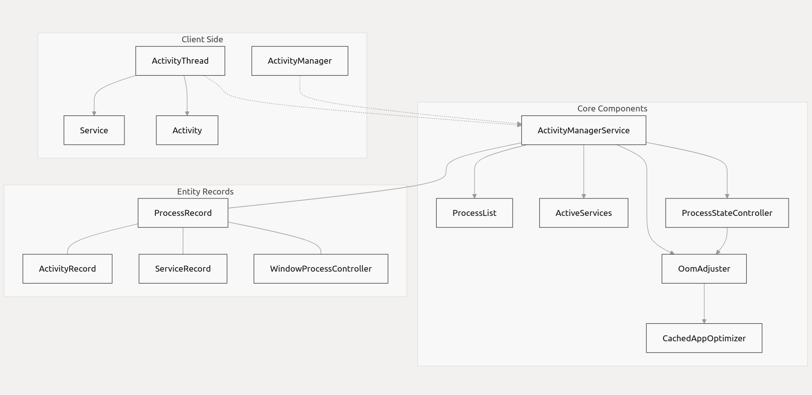
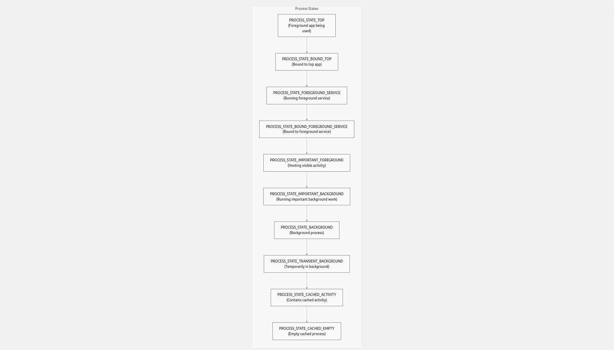
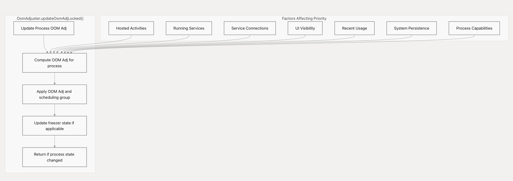
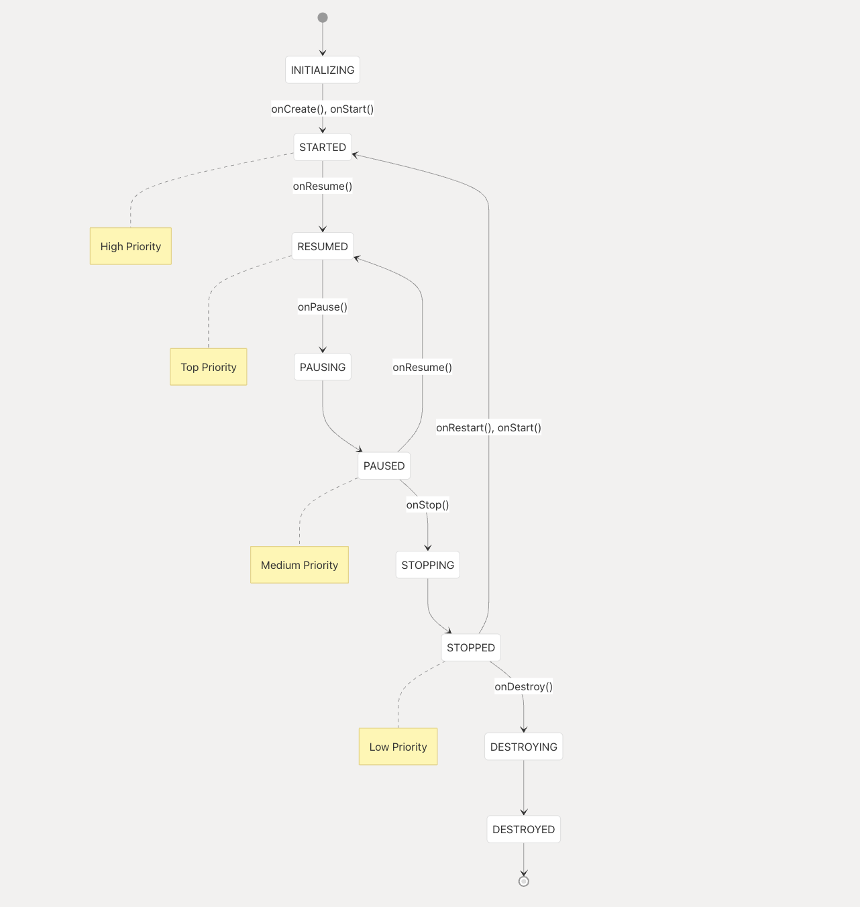
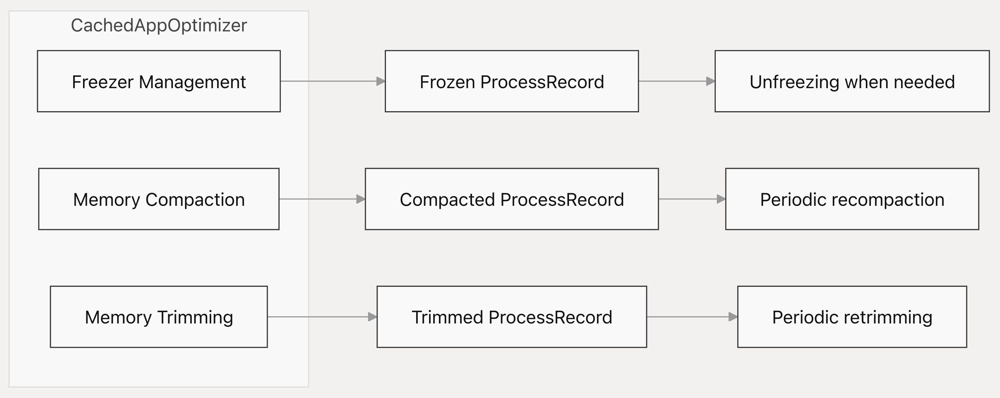
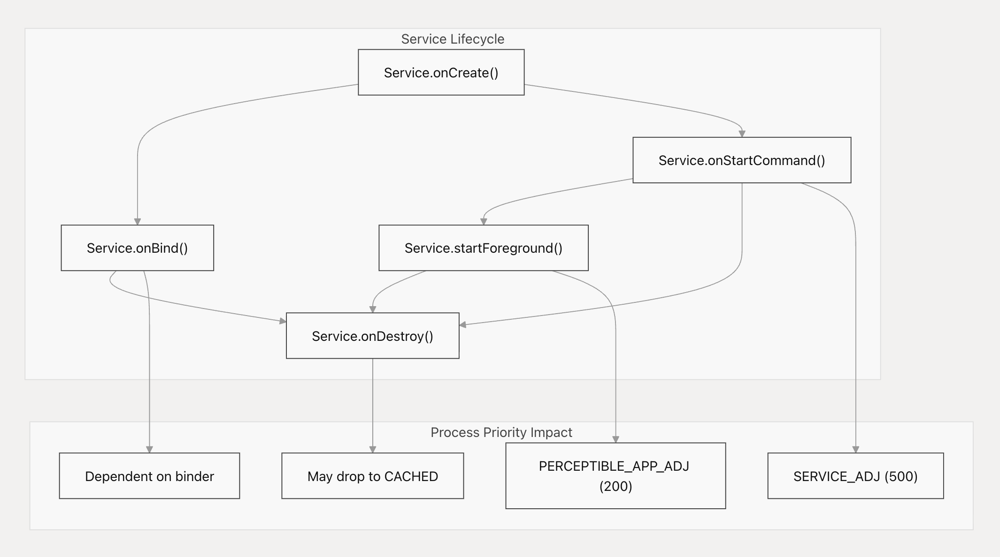

# Activity和Process管理

本文介绍Android是如何管理程序Processes和Activities的，包括他们的生命周期、优先级和资源分配。

## 概述
Android's的Activity和进程管理系统主要包括以下职责：

* 启动、维护和结束程序Processes
* 管理Activity生命周期和状态转换
* 根据对用户的重要性对Processes进行优先级排序
* 通过Process优先级调整和终止来优化内存使用
* 处理前/后台应用状态的切换

源代码：

* [services/core/java/com/android/server/am/ActivityManagerService.java](https://cs.android.com/android/platform/superproject/+/android-latest-release:frameworks/base/services/core/java/com/android/server/am/ActivityManagerService.java)
* [services/core/java/com/android/server/am/psc/OomAdjuster.java](https://cs.android.com/android/platform/superproject/+/android-latest-release:frameworks/base/services/core/java/com/android/server/am/psc/OomAdjuster.java)
* [services/core/java/com/android/server/am/ProcessList.java](https://cs.android.com/android/platform/superproject/+/android-latest-release:frameworks/base/services/core/java/com/android/server/am/ProcessList.java)
* [services/core/java/com/android/server/am/ActiveServices.java](https://cs.android.com/android/platform/superproject/+/android-latest-release:frameworks/base/services/core/java/com/android/server/am/ActiveServices.java)
* [services/core/java/com/android/server/wm/ActivityRecord.java](https://cs.android.com/android/platform/superproject/+/android-latest-release:frameworks/base/services/core/java/com/android/server/wm/ActivityRecord.java)

## 进程生命周期和状态
Android Process会经历从创建到终止的生命周期。当某个组件（如Activity、Service、Broadcast Receiver或Content Provider）需要运行时，系统会启动该进程；而当系统需要回收资源时，该进程可能会被终止。

### 进程状态
Process有各种各样的状态，它们反映了对用户的重要性：

源代码：

* [core/java/android/app/ActivityManager.java](https://cs.android.com/android/platform/superproject/+/android-latest-release:frameworks/base/core/java/android/app/ActivityManager.java)
* [services/core/java/com/android/server/am/ProcessList.java](https://cs.android.com/android/platform/superproject/+/android-latest-release:frameworks/base/services/core/java/com/android/server/am/ProcessList.java)

### OOM调整值

Android根据进程的重要程度为其分配内存不足(OOM)调整值，这些值从前台(0)到被缓存(999)不等。Linux内核低内存管理器会根据这些值来决定在系统内存不足时应先终止哪些进程。

|OOM调整类别 | 数值范围 | 描述 |
|-------|-------|-------|
|FOREGROUND_APP_ADJ | 0 | 正在运行前台Activity的进程|
|VISIBLE_APP_ADJ | 100 | 有可见Activity的进程|
|PERCEPTIBLE_APP_ADJ | 200 | 进程托管了可感知的组件|
|PERCEPTIBLE_MEDIUM_APP_ADJ | 225 | 将进程托管组件视为可感知 
|PERCEPTIBLE_LOW_APP_ADJ | 250 | 受系统限制的进程|
|BACKUP_APP_ADJ | 300 | 进程正在执行备份操作|
|HEAVY_WEIGHT_APP_ADJ | 400 | 进程运行了一个重量级的应用程序|
|SERVICE_ADJ | 500 | 进程运行了一个服务|
|HOME_APP_ADJ| 600 | 进程托管了桌面Activity|
|PREVIOUS_APP_ADJ | 700 | 上个Activity的进程|
|SERVICE_B_ADJ | 800 | 正在运行B级服务|
|CACHED_APP_MIN_ADJ | 900 | 开始缓存进程|
|CACHED_APP_MAX_ADJ | 999 | 缓存进程结束|

源代码:
* [core/java/com/android/server/am/ProcessList.java](https://cs.android.com/android/platform/superproject/+/android-latest-release:frameworks/base/services/core/java/com/android/server/am/ProcessList.java)
* [core/java/com/android/server/am/psc/OomAdjuster.java](https://cs.android.com/android/platform/superproject/+/android-latest-release:frameworks/base/services/core/java/com/android/server/am/psc/OomAdjuster.java) 

### 进程优先级

OOMAdjuster组件负责根据多种因素持续重新计算进程优先级，这种优先级的调整最终会影响进度调度和内存不足时进程终止的顺序。

源代码：

* [core/java/com/android/server/am/psc/OomAdjuster.java](https://cs.android.com/android/platform/superproject/+/android-latest-release:frameworks/base/services/core/java/com/android/server/am/psc/OomAdjuster.java) 
* [services/core/java/com/android/server/am/ActivityManagerService.java](https://cs.android.com/android/platform/superproject/+/android-latest-release:frameworks/base/services/core/java/com/android/server/am/ActivityManagerService.java)

### OOM调整机制

OOM调整由多种事件触发，包括：

1. Activity状态变更（在可见或不可见之间切换）
2. Service状态变更（启动或停止）
3. 绑定和解绑Service
4. UI可见变换
5. 进程开始或结束
6. 系统初始化
7. Shell命令

每种类型都有对应的错误码，例如 **OOM_ADJ_REASON_ACTIVITY**或**OOM_ADJ_REASON_UI_VISIBILITY**，有助于调试和追踪调整的进程。

源代码

* [core/java/com/android/server/am/psc/OomAdjuster.java](https://cs.android.com/android/platform/superproject/+/android-latest-release:frameworks/base/services/core/java/com/android/server/am/psc/OomAdjuster.java) 

## Activity和进程的关系

Acitivity是运行在进程中的可视化组件，Activity的状态直接影响其所在进程的优先级。

### Activity状态

源代码：

* [core/java/com/android/server/wm/ActivityRecord.java](https://cs.android.com/android/platform/superproject/+/android-latest-release:frameworks/base/services/core/java/com/android/server/wm/ActivityRecord.java)

### 状态转换对进程优先级的影响

当某个Activity状态发生变化时，可能会触发进程优先级的重新计算：

1. 一个Activity进入RESUMED状态时，通常会将其进程优先级变更到**FOREGROUND_APP_ADJ** (0)
2. 可见但暂停的的Activity会保持其进程处于高优先级（**VISIBLE_APP_ADJ** 或 **PERCEPTIBLE_APP_ADJ**）
3. 当某个Activity被停止时，其进程优先级会显著降低
4. 如果进程中所有Activity都被销毁，该进程优先级会变更为**CACHED_APP_ADJ**或终止

源代码：

* [core/java/com/android/server/wm/ActivityRecord.java](https://cs.android.com/android/platform/superproject/+/android-latest-release:frameworks/base/services/core/java/com/android/server/wm/ActivityRecord.java)
* [core/java/com/android/server/am/psc/OomAdjuster.java](https://cs.android.com/android/platform/superproject/+/android-latest-release:frameworks/base/services/core/java/com/android/server/am/psc/OomAdjuster.java) 

## 内存管理与资源优化

### 进程终止
当内存不足时，Android会按优先级值递增的的顺序（从最高OOM调整值开始）终止进程：
1. 空闲缓存进程（**CACHED_APP_MAX_ADJ**）
2. 有Activity的缓存进程（**CACHED_APP_MIN_ADJ**至**CACHED_APP_MAX_ADJ-1**）
3. 后台进程（**SERVICE_B_ADJ**至**PREVIOUS_APP_ADJ**）
4. 服务进程（**SERVICE_ADJ**）
5. 桌面进程（**HOME_APP_ADJ**）
6. 可感知的进程（**PERCEPTIBLE_APP_ADJ**）
7. 可见进程（**VISIBLE_APP_ADJ**）
8. 前台进程（**FOREGROUND_APP_ADJ**）

通常，这种终止操作由内核的低内存管理器根据系统设置的OOM调整值来处理。

源代码:
* [core/java/com/android/server/am/ProcessList.java](https://cs.android.com/android/platform/superproject/+/android-latest-release:frameworks/base/services/core/java/com/android/server/am/ProcessList.java)

### 缓存应用优化
CachedAppOptimizer 组件用于管理缓存进程的优化以减少其内存占用：
1. 进程冻结：暂停执行缓存的进程，节省CPU资源
2. 压缩：将缓存进程的内存进行压缩，减少碎片化
3. 削减：请求进程减少其内存使用量

源代码：

* [core/java/com/android/server/am/CachedAppOptimizer.java](https://cs.android.com/android/platform/superproject/+/android-latest-release:frameworks/base/services/core/java/com/android/server/am/CachedAppOptimizer.java)

## 进程能力
Android 11引入了进程能力的概念，用于定义进程可以执行的敏感操作。

|能力  | 描述 |
|-------|-------|
|**PROCESS_CAPABILITY_FOREGROUND_LOCATION**|在前台时可访问地理位置|
|**PROCESS_CAPABILITY_FOREGROUND_CAMERA**|可访问摄像头|
|**PROCESS_CAPABILITY_FOREGROUND_MICROPHONE**|可访问麦克风|
|**PROCESS_CAPABILITY_FOREGROUND_AUDIO_CONTROL**|可控制音量|
|**PROCESS_CAPABILITY_BFSL**|可从后台启动前台服务|
|**PROCESS_CAPABILITY_POWER_RESTRICTED_NETWORK**|电量限制模式时可访问网络|
|**PROCESS_CAPABILITY_USER_RESTRICTED_NETWORK**|用户受限时可访问访问|

能力根据以下依据授予:
1. 进程状态（高状态具有更多能力）
2. 服务类型（例如：前台服务具有摄像头类型的剧有获取相机的能力）
3. 绑定关系（能力可以从客户端传递到服务端）

源代码：
* [core/java/android/app/ActivityManager.java](https://cs.android.com/android/platform/superproject/+/android-latest-release:frameworks/base/core/java/android/app/ActivityManager.java)
* [core/java/com/android/server/am/psc/OomAdjuster.java](https://cs.android.com/android/platform/superproject/+/android-latest-release:frameworks/base/services/core/java/com/android/server/am/psc/OomAdjuster.java) 

## 服务管理
服务是可以在后台运行且无用户界面的组件，他们对进程优先级有重要影响：
1. **前台服务**：接收高优先级的临近可见Activities
2. **绑定服务**：继承绑定客户端的优先级
3. **后台服务**：以较低优先级运行

源代码
* [services/core/java/com/android/server/am/ActiveServices.java](https://cs.android.com/android/platform/superproject/+/android-latest-release:frameworks/base/services/core/java/com/android/server/am/ActiveServices.java)

### 前台服务限制
Android对应用启动前台服务的权限进行了越来越多的限制，尤其是从后台启动时。主要限制包括：
1. 后台应用需要特殊权限才能启动前台应用
2. 某些前台服务类型（如相机、位置、麦克风）有额外的限制
3. 短时前台服务有时间限制

源代码：
* [services/core/java/com/android/server/am/ActiveServices.java](https://cs.android.com/android/platform/superproject/+/android-latest-release:frameworks/base/services/core/java/com/android/server/am/ActiveServices.java)
* [services/core/java/com/android/server/am/ActivityManagerConstants.java](https://cs.android.com/android/platform/superproject/+/android-latest-release:frameworks/base/services/core/java/com/android/server/am/ActivityManagerConstants.java)

## 高级主题
### 进程启动序列

源代码：
* [core/java/com/android/server/am/ProcessList.java](https://cs.android.com/android/platform/superproject/+/android-latest-release:frameworks/base/services/core/java/com/android/server/am/ProcessList.java)
* [services/core/java/com/android/server/am/ActivityManagerService.java](https://cs.android.com/android/platform/superproject/+/android-latest-release:frameworks/base/services/core/java/com/android/server/am/ActivityManagerService.java)
* [services/core/java/com/android/server/am/AppStartInfoTracker.java](https://cs.android.com/android/platform/superproject/+/android-latest-release:frameworks/base/services/core/java/com/android/server/am/AppStartInfoTracker.java)

### UI兼容模式
当某个Activity在与设计尺寸或方向不同的屏幕上运行时，Android可能会启动兼容模式：
1. Activity以与预期尺寸相匹配的虚拟显示尺寸运行
2. 内容可能会被缩放以适应物理显示
3. 不同显示设备的固定方向应用需特殊处理

这确保了专为特定屏幕尺寸设计的应用仍能在其他屏幕尺寸上正常运行。

源代码：
* [services/tests/wmtests/src/com/android/server/wm/SizeCompatTests.java](https://cs.android.com/android/platform/superproject/+/android-latest-release:frameworks/base/services/tests/wmtests/src/com/android/server/wm/SizeCompatTests.java)
* [services/core/java/com/android/server/wm/ActivityRecord.java](https://cs.android.com/android/platform/superproject/+/android-latest-release:frameworks/base/services/core/java/com/android/server/wm/ActivityRecord.java)

### 壁纸管理
显示壁纸的Activities会做特殊处理：
1. 壁纸进程会获得更高的优先级
2. 壁纸与Activities的可见性相一致
3. 在切换带有壁纸的Activies时，会应用特殊动画

源代码：
* [services/core/java/com/android/server/wm/WallpaperController.java](https://cs.android.com/android/platform/superproject/+/android-latest-release:frameworks/base/services/core/java/com/android/server/wm/WallpaperController.java)

### 配置管理
进程管理系统通过以下方式处理配置变更（如方向、区域设置等）：
1. 配置更改时重新计算进程的优先级
2. 管理因配置变更而导致Activity的重建
3. 处理受配置影响进程能力

源代码：
* [services/core/java/com/android/server/wm/ActivityRecord.java](https://cs.android.com/android/platform/superproject/+/android-latest-release:frameworks/base/services/core/java/com/android/server/wm/ActivityRecord.java)
* [core/java/android/content/pm/ActivityInfo.java](https://cs.android.com/android/platform/superproject/+/android-latest-release:frameworks/base/core/java/android/content/pm/ActivityInfo.java)